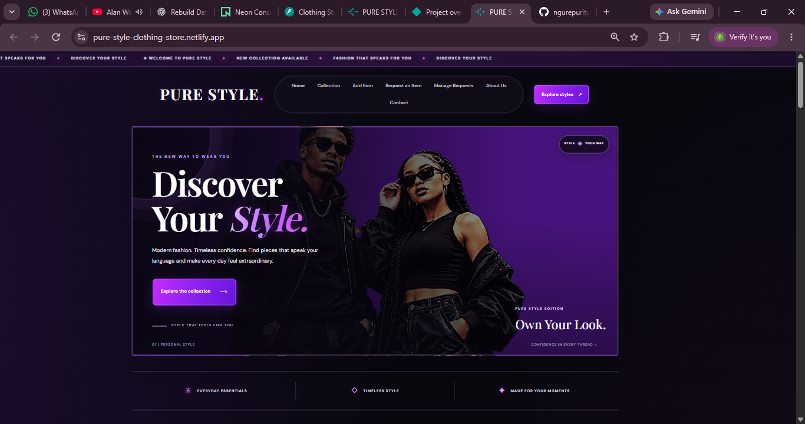
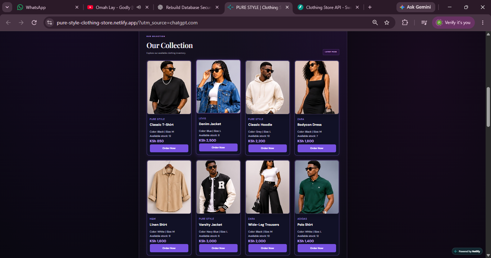
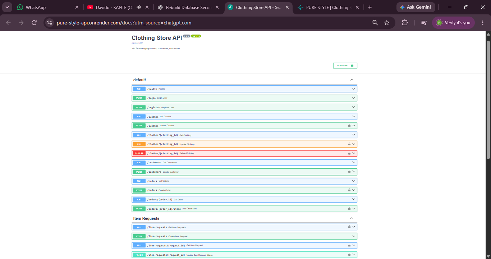
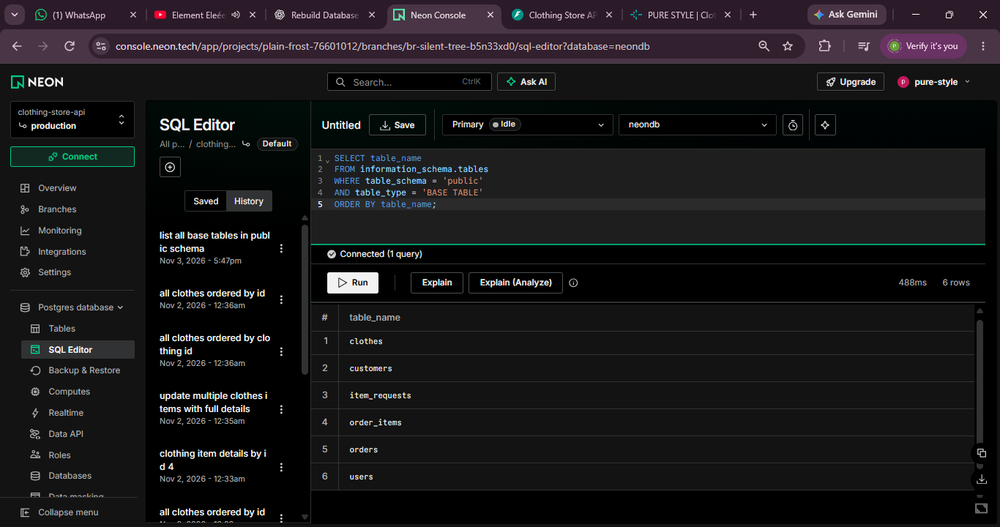
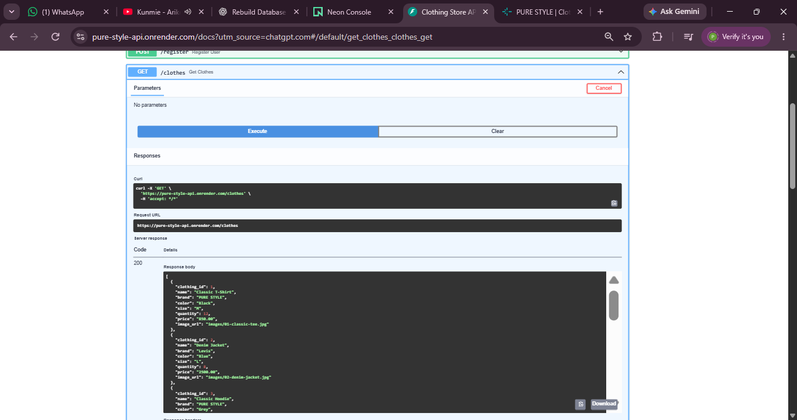

# PURE STYLE – Clothing Store API

## 1. Live Project Links

- **Live Website:** https://pure-style-clothing-store.netlify.app/
- **Live API:** https://pure-style-api.onrender.com
- **API Documentation (Swagger UI):** https://pure-style-api.onrender.com/docs
- **GitHub Repository:** https://github.com/ngurepurity64-gif/Clothing-Store-API

---

## 2. Project Overview

PURE STYLE is a clothing store web application developed to manage clothing inventory and provide an online platform for displaying clothing products.

The project consists of a frontend developed using HTML, CSS and JavaScript, and a backend developed using Python and FastAPI. The backend communicates with a PostgreSQL database to store and manage application data.

The frontend retrieves clothing records from the backend API using JavaScript Fetch API. The application is deployed online, with the frontend hosted on Netlify, the backend hosted on Render, and the database hosted on Neon PostgreSQL.

---

## Demo Account Access

PURE STYLE supports user registration and secure authentication using JSON Web Tokens (JWT).

New users can create an account through the website and log in to access the application's authentication features.

### Getting Started

1. Visit the live application: https://pure-style-clothing-store.netlify.app/
2. Navigate to the registration section.
3. Create an account using a valid email address and password.
4. Log in using your registered credentials.
5. Once authenticated, you can access the available features according to your account permissions.

### API Authentication

The API also supports authentication through Swagger UI:

- API Documentation: https://pure-style-api.onrender.com/docs
- Registration endpoint: `POST /register`
- Login endpoint: `POST /login`

Authentication is handled using JWT access tokens to protect restricted API endpoints.

**Note:** Users should register their own accounts. No personal account credentials are published in this repository.

## 3. Technologies Used

### Frontend

- HTML5 – Used to structure the web pages.
- CSS3 – Used to style and design the website.
- JavaScript – Used to make the website interactive and communicate with the backend API.

### Backend

- Python – Main programming language used for backend development.
- FastAPI – Used to build REST API endpoints.
- SQLAlchemy – Used to interact with the database.
- Pydantic – Used for data validation.
- JWT – Used for user authentication.
- Passlib and Bcrypt – Used for password hashing.

### Database

- PostgreSQL – Used to store application data.
- Neon – Used to host the PostgreSQL database online.

### Development and Deployment Tools

- Visual Studio Code – Code editor.
- Git – Version control.
- GitHub – Source code repository.
- Render – Backend hosting platform.
- Netlify – Frontend hosting platform.
- Swagger UI – Used to test and document API endpoints.
- Pytest and HTTPX – Used for backend testing.

---

## 4. Key Features

### Backend Features

- User registration and login.
- Password hashing.
- JWT-based authentication.
- Clothing inventory management.
- Customer management.
- Order management.
- Order-item management.
- Item request management.
- Input validation.
- Error handling.
- PostgreSQL database integration.

### Frontend Features

- Responsive clothing store website.
- Clothing product display.
- Dynamic loading of clothing records from the API.
- Clothing submission form.
- JavaScript Fetch API integration.
- Product images.
- Mobile-friendly layout.
- Navy, purple and lavender visual theme.

- Admin dashboard for managing store operations.
- Customer management screen for viewing active customer profiles.
- Order management screen for viewing customer orders.
- Special request management with status updates.
- Role-based visibility of administrator features.

### User Roles and Permissions

The application supports two user roles:

**Customer**

- Register and log in.
- Browse available clothing.
- Place clothing orders.
- Submit special item requests.
- View their permitted account information.

**Administrator**

- Log in using an administrator account.
- Add clothing items.
- View customer profiles.
- View and manage customer orders.
- View and update special item requests.

Access to restricted API endpoints is controlled through authentication and role-based authorization.

### Order Processing

The application supports order creation and order-item management.

When a customer places an order:

1. The customer selects an available clothing item.
2. The system checks the customer's authentication and profile.
3. An order is created.
4. The selected clothing item is added to the order.
5. The available clothing stock is updated.
6. The administrator can view the order through the management section.

## 5. Project Structure

The project is organized into frontend, backend, database, SQL and testing files.

```text
Clothing-Store-API/
│
├── frontend/
│   ├── images/
│   ├── index.html
│   ├── style.css
│   └── script.js
│
├── routers/
│   ├── __init__.py
│   ├── auth.py
│   ├── clothes.py
│   ├── customers.py
│   ├── orders.py
│   └── item_requests.py
│
├── tests/
│   └── test_main.py
│
├── SQL/
│   ├── schema.sql
│   ├── clothes_table_rows.sql
│   ├── create_database_clothingstore.sql
│   ├── insert_customers.sql
│   ├── join_queries.sql
│   └── rows_displayed.sql
│
├── database.py
├── models.py
├── schemas.py
├── main.py
├── requirements.txt
├── .env
├── .env.example
├── .gitignore
└── README.md
```

**Note:** The `.env` file contains private configuration values and should not be uploaded to GitHub. The `.env.example` file provides sample configuration names without exposing secret values.

---

## 6. Database Design

The application uses PostgreSQL to store and manage its data.

The database contains five main tables:

| Table       | Purpose                                     |
| ----------- | ------------------------------------------- |
| clothes     | Stores clothing product information.        |
| customers   | Stores customer information.                |
| orders      | Stores customer order information.          |
| order_items | Stores items associated with orders.        |
| users       | Stores registered user account information. |

### Clothes Table

The clothes table stores clothing inventory details, including:

- clothing_id – Unique identifier for each clothing item.
- name – Name of the clothing item.
- brand – Brand of the clothing item.
- color – Clothing color.
- size – Clothing size.
- quantity – Available stock.
- price – Price of the clothing item.

The database schema is available in the `SQL/schema.sql` file.

---

## 7. API Endpoints

The backend provides REST API endpoints for managing the application.

The API can be accessed through:

https://pure-style-api.onrender.com

### Health Check

| Method | Endpoint | Description                        |
| ------ | -------- | ---------------------------------- |
| GET    | /health  | Checks whether the API is running. |

### Authentication

| Method | Endpoint  | Description           |
| ------ | --------- | --------------------- |
| POST   | /register | Registers a new user. |
| POST   | /login    | Authenticates a user. |

#### Current User and Profile Endpoints

These endpoints allow authenticated users to retrieve their account information and customer profile.

| Method | Endpoint        | Description                                                                                      | Access                  |
| ------ | --------------- | ------------------------------------------------------------------------------------------------ | ----------------------- |
| GET    | `/me`           | Retrieves details of the currently logged-in user, including their account information and role. | Authenticated users     |
| GET    | `/customers/me` | Retrieves the customer profile associated with the currently logged-in customer.                 | Authenticated customers |

**Endpoint details:**

**1. GET `/me` – Get Current User**

- Returns information about the user making the request.
- Requires a valid JWT access token.
- Helps the application identify the logged-in user and their role (customer or admin).
- Returns an authentication error if the token is missing or invalid.

**2. GET `/customers/me` – Get Current Customer Profile**

- Retrieves the customer profile belonging to the logged-in customer.
- Requires a valid JWT access token.
- Allows customers to access their own profile without viewing another customer's private information.
- Returns an appropriate error if the customer profile does not exist.

### Clothing Management

| Method | Endpoint               | Description                         |
| ------ | ---------------------- | ----------------------------------- |
| GET    | /clothes               | Retrieves all clothing items.       |
| POST   | /clothes               | Adds a new clothing item.           |
| GET    | /clothes/{clothing_id} | Retrieves a specific clothing item. |
| PUT    | /clothes/{clothing_id} | Updates a clothing item.            |
| DELETE | /clothes/{clothing_id} | Deletes a clothing item.            |

### Customer Management

| Method | Endpoint   | Description                 |
| ------ | ---------- | --------------------------- |
| GET    | /customers | Retrieves customer records. |
| POST   | /customers | Adds a new customer.        |

### Order Management

| Method | Endpoint                 | Description                 |
| ------ | ------------------------ | --------------------------- |
| GET    | /orders                  | Retrieves orders.           |
| POST   | /orders                  | Creates a new order.        |
| GET    | /orders/{order_id}       | Retrieves a specific order. |
| POST   | /orders/{order_id}/items | Adds an item to an order.   |

### Item Requests

| Method | Endpoint                    | Description                        |
| ------ | --------------------------- | ---------------------------------- |
| GET    | /item-requests              | Retrieves item requests.           |
| POST   | /item-requests              | Creates an item request.           |
| GET    | /item-requests/{request_id} | Retrieves a specific item request. |
| PATCH  | /item-requests/{request_id} | Updates an item request.           |

The interactive API documentation is available through Swagger UI:

https://pure-style-api.onrender.com/docs

---

## 8. Installation and Setup

### Requirements

Before running the project locally, ensure that the following are installed:

- Python 3.12 or later.
- PostgreSQL or access to a PostgreSQL database.
- Visual Studio Code or another code editor.
- Git.
- A web browser.

### Step 1: Clone the Repository

Open the terminal and run:

```bash
git clone https://github.com/ngurepurity64-gif/Clothing-Store-API.git
```

### Step 2: Open the Project Folder

```bash
cd Clothing-Store-API
```

### Step 3: Create a Virtual Environment

```bash
python -m venv .venv
```

### Step 4: Activate the Virtual Environment

On Windows:

```bash
.venv\Scripts\activate
```

### Step 5: Install Dependencies

```bash
pip install -r requirements.txt
```

### Step 6: Configure Environment Variables

Create a `.env` file in the project root directory.

Add the required configuration values, such as:

```env
DATABASE_URL=your_database_connection_string
SECRET_KEY=your_secret_key
```

Replace the example values with your actual database connection string and a securely generated secret key. Do not share or commit your real `.env` file.

### Step 7: Set Up the Database

Create a PostgreSQL database and execute the SQL statements in:

```text
SQL/schema.sql
```

This creates the database tables required by the application.

---

## 9. Running the Backend API

After completing the installation and database configuration, activate the virtual environment and run:

```bash
uvicorn main:app --reload
```

The backend API will be available at:

```text
http://127.0.0.1:8000
```

Open the API documentation in a browser:

```text
http://127.0.0.1:8000/docs
```

Swagger UI allows users to view and test the available API endpoints.

---

## 10. Frontend Development and API Integration

The frontend is developed using HTML, CSS and JavaScript.

The main frontend files are:

- `index.html` – Provides the structure of the website.
- `style.css` – Controls the appearance and layout of the website.
- `script.js` – Handles interactions and communication with the backend.

The JavaScript Fetch API is used to retrieve clothing records from the backend.

The API base URL is configured in `frontend/script.js`:

```javascript
const API_BASE_URL = "https://pure-style-api.onrender.com";
```

The frontend sends requests to the backend API to retrieve and display clothing records.

The frontend does not connect directly to the PostgreSQL database. Instead, the backend API handles communication with the database.

---

## 11. Validation and Error Handling

The application uses Pydantic schemas to validate incoming data.

Validation helps ensure that the information submitted to the API follows the required data formats and conditions.

The application also handles errors such as:

- Missing records.
- Invalid input data.
- Missing authentication credentials.
- Invalid authentication tokens.
- Database-related errors.

HTTP status codes are used to communicate the results of API requests.

Examples include:

| Status Code | Meaning                             |
| ----------- | ----------------------------------- |
| 200         | Request successful.                 |
| 201         | Resource created successfully.      |
| 401         | Authentication required or invalid. |
| 404         | Requested resource not found.       |
| 422         | Validation error.                   |
| 500         | Internal server error.              |

---

## 12. Authentication and Security

The application uses JWT-based authentication to protect secured API endpoints.

Security features include:

- User registration and login.
- Password hashing using Bcrypt.
- JWT access tokens.
- Token validation.
- Environment variables for sensitive configuration.
- `.gitignore` to prevent private files from being uploaded to GitHub.

The secret key is stored in the `.env` file and should never be exposed publicly.

---

## 13. Testing

The backend includes tests using Pytest and HTTPX.

To run the tests, execute:

```bash
python -m pytest -q
```

The tests help check whether the API behaves as expected.

The API can also be tested manually through Swagger UI:

```text
https://pure-style-api.onrender.com/docs
```

Swagger UI provides an interactive way to test API requests and view their responses.

---

## 14. Screenshots

Screenshots of the project will be added in this section to demonstrate the website, API documentation and database.

### 14.1 PURE STYLE Homepage



### 14.2 Clothing Products Display



### 14.3 Swagger API Documentation



### 14.4 Database Tables



### 14.5 API Testing Results

### 14.5 API Testing Results



---

## 15. Deployment

The project is deployed using three platforms.

### Frontend Deployment – Netlify

The frontend website is hosted on Netlify.

Live website:

https://pure-style-clothing-store.netlify.app/

### Backend Deployment – Render

The FastAPI backend is hosted on Render.

API URL:

https://pure-style-api.onrender.com

Swagger documentation:

https://pure-style-api.onrender.com/docs

### Database Deployment – Neon

The PostgreSQL database is hosted on Neon.

Neon provides the database connection used by the deployed backend.

---

## 16. Git and GitHub

Git was used for version control during development.

GitHub was used to store and manage the project source code.

Repository:

https://github.com/ngurepurity64-gif/Clothing-Store-API

Common Git commands used during development include:

```bash
git status
git add .
git commit -m "Update project"
git push origin main
```

---

## 17. Project Status

The project has been developed with a frontend, backend API and PostgreSQL database.

The frontend is deployed on Netlify, the backend API is deployed on Render, and the database is hosted on Neon.

The live website retrieves clothing records from the deployed backend API and displays the available products.

---

## 18. Conclusion

PURE STYLE demonstrates the development of a clothing store application using frontend web technologies, Python, FastAPI and PostgreSQL.

The project provides practical experience in frontend development, REST API development, database management, authentication, validation, testing, version control and deployment.
